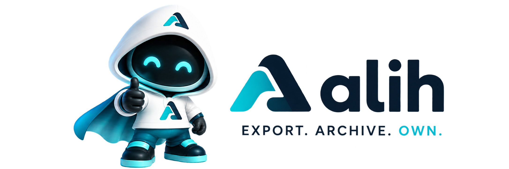

<p align="center">
  
</p>

<p align="center">
  <a href="https://github.com/rinorouu/alih/actions/workflows/ci.yml"></a>
  <a href="https://github.com/rinorouu/alih/releases/latest"></a>
  <a href="https://github.com/rinorouu/alih/blob/main/LICENSE"></a>
  <a href="https://github.com/rinorouu/alih/blob/main/go.mod"></a>
</p>

# Alih

Alih creates local, portable, and independently verified backups of SaaS data.
It preserves the source API evidence, builds a readable local archive, and
reports exactly what was recovered and what could not be proven.

> **Alpha:** use Alih alongside your existing backup and data-protection
> practices. ClickUp is the reference connector; Notion support is experimental.

## Why Alih

- **Read-only:** Alih does not create, edit, or delete source data.
- **Local-first:** data and credentials stay on your machine. There is no Alih
  cloud backend or telemetry.
- **Verifiable:** expected and archived records are reconciled, then the archive
  is checked independently.
- **Fail-closed:** missing data, corruption, broken references, or unsupported
  claims cannot silently produce a clean result.
- **Portable:** the result includes SQLite data, raw API evidence, checksums,
  and a human-readable recovery report.

## Install

The official installers download the correct binary for your platform, verify
its SHA-256 checksum, and install it for the current user without `sudo` or
Administrator privileges.

### Linux, macOS, or WSL

```bash
curl -fsSL https://github.com/rinorouu/alih/releases/latest/download/install.sh | sh
~/.local/bin/alih --version
```

Open a new terminal if `alih` is not found immediately afterward.

### Windows

Run in PowerShell:

```powershell
irm https://github.com/rinorouu/alih/releases/latest/download/install.ps1 | iex
& "$env:LOCALAPPDATA\Alih\bin\alih.exe" --version
```

The default executable is `%LOCALAPPDATA%\Alih\bin\alih.exe`. Open a new
terminal if the updated user `PATH` is not visible yet.

The Windows binary is currently unsigned. Windows may block it because the
publisher cannot be verified. Keep Smart App Control, Microsoft Defender, and
SmartScreen enabled; use Alih through WSL if native execution is blocked.

Prebuilt binaries, installers, and `SHA256SUMS` are also available on the
[Releases page](https://github.com/rinorouu/alih/releases/latest).

## First backup

Alih is self-managed by default. The setup command records that choice locally
and points you to the next step:

```text
alih setup
```

### ClickUp

Set a personal API token, verify it, then create a backup:

```bash
export ALIH_CLICKUP_TOKEN='YOUR_CLICKUP_TOKEN'
alih auth
unset ALIH_CLICKUP_TOKEN
alih backup
```

In Windows PowerShell:

```powershell
$env:ALIH_CLICKUP_TOKEN = 'YOUR_CLICKUP_TOKEN'
alih auth
Remove-Item Env:ALIH_CLICKUP_TOKEN
alih backup
```

### Notion (experimental)

Select the Notion connector explicitly:

```bash
export ALIH_NOTION_TOKEN='YOUR_NOTION_TOKEN'
alih --connector notion auth
unset ALIH_NOTION_TOKEN
alih --connector notion backup
```

If the authenticated account can access more than one Workspace, add
`--workspace-id WORKSPACE_ID` to `backup`.

A completed backup is written to:

```text
~/Alih/<workspace>/<UTC-start-time>/
├── archive/
└── recovery-report.html
```

The token is never accepted as a command-line argument or written into an
archive. `auth` verifies and stores it in the current user's configuration
directory. If no local copy should be kept, provide the token to each `backup`,
`scan`, or `extract` run with `ALIH_SAVE_CREDENTIAL=0`; do not run `auth`, whose
purpose is to save the credential.

## What a backup contains

```text
archive/
├── alih.db          portable SQLite data
├── manifest.json    inventory, capabilities, and checksums
├── schema.json      database schema description
├── raw/             original API evidence
└── attachments/     downloaded files
```

The recovery report sits beside the sealed archive so the archive's checksums
remain independently verifiable.

Successful backup results are:

| Result | Meaning |
| --- | --- |
| `VERIFIED` | Everything expected within the supported scope was archived and proven. |
| `VERIFIED_WITH_LIMITATIONS` | Supported data was proven, with limitations stated explicitly. |

`INCOMPLETE` and `FAILED` are not successful backups and return a non-zero exit
code.

## Useful commands

```text
alih status [--json] [--refresh] [--reconcile]
alih scan [--workspace-id ID] [--json]
alih verify --archive PATH [--json]
alih report --archive PATH [--format text|html|json]
alih organize --archive PATH --output PATH [--json]
alih schedule check|preview|install|inspect|remove
alih notify [--json]
```

Run `alih <command> --help` for complete options. Use `--connector notion`
before a command to operate on Notion; ClickUp remains the default.

## Important limits

Alih proves the contents and internal consistency of the archive it creates. It
does not claim that:

- the source exposed an atomic point-in-time snapshot;
- the authenticated identity could see every object in the account;
- every source-side automation, permission, view, or computed behavior can be
  reconstructed;
- verification of an archive proves that the live source is still unchanged;
- a restore or cross-SaaS migration workflow exists in the current Alpha.

Treat an archive as sensitive as the Workspace it contains. Raw evidence can
include short-lived provider-signed attachment URLs.

## Operation modes

Self-managed mode is free, open source, and the default. `alih setup` can also
record interest in Alih Assistance, an optional managed service that is not yet
available. This contacts nobody, creates no account, and unlocks no features.

## Documentation

- [Connector support and contracts](docs/connectors.md)
- [Operator guide](OPERATOR.md)
- [Hardening notes](HARDENING.md)
- [Changelog](CHANGELOG.md)
- [Contributing](CONTRIBUTING.md)
- [Security policy](SECURITY.md)

## Build from source

Alih requires Go 1.22 or newer and a working C compiler because its SQLite
driver uses cgo.

```bash
git clone https://github.com/rinorouu/alih.git
cd alih
go build -o alih ./cmd/alih
go test ./...
```

## License

Alih is free and open-source software licensed under the
[Apache License 2.0](LICENSE).

Copyright 2025 rinorouu.
